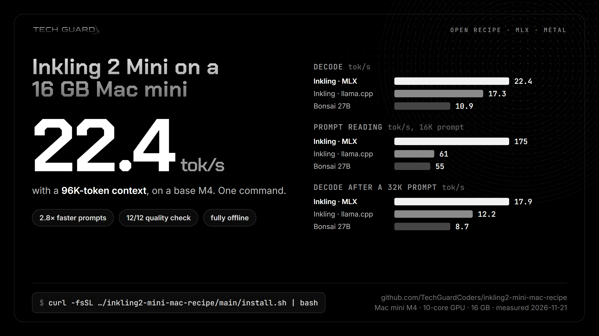

# Inkling 2 Mini on a 16 GB Mac mini

<p align="center"></p>

Thinking Machines' [Inkling 2 Mini](https://huggingface.co/thinkingmachines/Inkling-2-Mini) with a **96K-token
context** on a **base M4 Mac mini with 16 GB**, as a local OpenAI-compatible server. One command installs it.
A second command benchmarks it on your own Mac, against
[Ternary Bonsai 2 27B](https://huggingface.co/prism-ml/Ternary-Bonsai-2-27B-gguf) too if you like.

```bash
curl -fsSL https://raw.githubusercontent.com/TechGuardCoders/inkling2-mini-mac-recipe/main/install.sh | bash
```

Landing page: <https://techguardcoders.github.io/inkling2-mini-mac-recipe/>

## Results

Base Mac mini (M4, 10-core GPU, 16 GB, macOS 26.5), 96K context on every row, one model loaded at a time, the
repo's own benchmark (`mini-llm bench --depth 32768`). Speeds are the server's timings. Measured 2026-11-21.

| | **Inkling 2 Mini, MLX** (default) | Inkling 2 Mini, llama.cpp | Ternary Bonsai 2 27B |
| --- | --- | --- | --- |
| decode, short prompt | **22.4 tok/s** | 17.3 tok/s | 10.9 tok/s |
| prefill, 4K / 16K prompt | **190 / 175 tok/s** | 68 / 61 tok/s | 58 / 55 tok/s |
| 32K-token prompt: first token | **202 s** | 690 s | 647 s |
| 32K-token prompt: decode | **17.9 tok/s** | 12.2 tok/s | 8.7 tok/s |
| needle at 32K | found | found | found |
| 12 known-answer questions | 12/12 | 12/12 | 11/12 |
| weights | 10.9 GB, oQ2.5e (MLX) | 12.6 GB, AD-IQ3_XXS (GGUF) | 7.2 GB, PQ2_0 (GGUF) |

At a nearly full window (a 94K-token prompt) the MLX build answers after 11.7 minutes and then decodes at 15.2
tok/s. The llama.cpp build takes 42.6 minutes and decodes at 11.2 tok/s. Both find facts planted in the prompt. Raw results:
[`results/`](results/).

## What makes it fit

Inkling 2 Mini is a mixture-of-experts model whose middle layers run three times per token: 48 layer passes,
40 of them sliding-window attention over the last 1,024 tokens. The default build runs it on
[MLX](https://github.com/ml-explore/mlx) through a small server in this repo,
[`engine/inkserve.py`](engine/inkserve.py), built on [oMLX](https://github.com/jundot/omlx)'s model code. It
changes three things:

1. **Window caches for the 40 sliding passes.** oMLX keeps the full history on all 48 passes (~192 KB per token)
   and so fits only ~7K tokens on 16 GB. Output is token-for-token identical.
2. **8-bit keys and values on the 8 global passes**, allocated once: 1.6 GB at 96K.
3. **A split-K Metal decode kernel** ([`engine/q8attn.py`](engine/q8attn.py)) that reads that 8-bit cache directly:
   22 ms per token at 96K against 73 ms for plain MLX ops.

Every experiment, with its control, is in [docs/RECIPE.md](docs/RECIPE.md). That includes:
- why the drafter doesn't help on this chip;
- which GGUF is broken;
- why llama.cpp needs `-ub 32` at 96K.

## Requirements

- Apple Silicon Mac with 16 GB or more, macOS 14 or newer, ~14 GB free disk.
- [Homebrew](https://brew.sh) for the MLX build (the installer adds oMLX from its tap, `jundot/omlx`). Without
  Homebrew the installer sets up the llama.cpp build instead, with no compiler and no Python.
- The GPU memory limit raised to 14.5 GB. macOS allows ~10.7 GB of 16 by default. The installer asks before
  running `sudo sysctl iogpu.wired_limit_mb=14500`, and can make it survive reboots.
- Close big apps while it runs. A Docker VM holding 10 GB will not leave room.

## What the installer does

It's a short script, so you can read [`install.sh`](install.sh) first. `--dry-run` checks your Mac and prints the
plan without changing anything. It then:

1. Checks the Mac: Apple Silicon, macOS 14+, 16 GB, disk space.
2. Installs the engine. For the default build that's oMLX 0.8.2 via Homebrew. For the llama.cpp builds it's a
   prebuilt llama.cpp release, SHA-256 checked.
3. Downloads the model from Hugging Face at a pinned revision and checks every file's SHA-256. Interrupted
   downloads resume.
4. Asks before raising the GPU memory limit.
5. Starts the server as a login item on `127.0.0.1:8080` (loopback only), restarted if it crashes.
6. Runs the 12 known-answer questions, because a fast model that outputs garbage is the most common failure.

Options: `--models inkling,inkling-gguf,bonsai`, `--port N`, `--prefix DIR`, `--no-start`, `--no-wired-limit`,
`--no-path`.

## Use it

```bash
curl http://127.0.0.1:8080/v1/chat/completions -H 'Content-Type: application/json' -d '{
  "model": "inkling-2-mini",
  "messages": [{"role": "user", "content": "Explain mixture-of-experts in two sentences."}]
}'
```

Any OpenAI-compatible client works with base URL `http://127.0.0.1:8080/v1`; the API key can be anything. The
MLX server supports streaming, `reasoning_content` and tool calls. It serves one request at a time and keeps the
conversation's cache, so a new turn only processes its new tokens. `reasoning_effort` (`low`, `medium`, `high`)
goes in the request or in `chat_template_kwargs`.

| command | what it does |
| --- | --- |
| `mini-llm status` | what's installed and running |
| `mini-llm bench` | decode, prefill and the quality check (~10 min); `--depth 32768` adds a needle test |
| `mini-llm use inkling-gguf` | switch to the llama.cpp build (downloads it the first time) |
| `mini-llm use bonsai` | switch to Ternary Bonsai 2 27B |
| `mini-llm stop` / `start` / `logs` | the server |
| `mini-llm uninstall` | remove the login item (models stay in `~/.mini-llm` until you delete it) |

## Credits

This recipe is a thin layer over other people's work. Full notices are in [NOTICE](NOTICE).

- [Thinking Machines Lab](https://huggingface.co/thinkingmachines/Inkling-2-Mini) for Inkling 2 Mini.
- [oMLX](https://github.com/jundot/omlx) for the MLX model code, chat handling and output parser that inkserve
  runs on. [MLX and mlx-lm](https://github.com/ml-explore) are by Apple.
- [mlx-community](https://huggingface.co/mlx-community/Inkling-2-Mini-oQ2.5e-mtp) for the MLX weights, and
  [AtomicChat](https://huggingface.co/AtomicChat/Inkling-2-Mini-GGUF) for the GGUF.
- [llama.cpp / ggml](https://github.com/ggml-org/llama.cpp).
- [PrismML](https://huggingface.co/prism-ml/Ternary-Bonsai-2-27B-gguf) for Ternary Bonsai 2 and
  [their llama.cpp fork](https://github.com/PrismML-Eng/llama.cpp). Bonsai is from
  [Qwen](https://huggingface.co/Qwen)'s Qwen3.8-27B.
- [Sybil Solutions](https://github.com/sybil-solutions/inference-optimisation-skill) for the tuning method.

## License

Apache-2.0 for this repo's scripts, server, kernel and docs ([LICENSE](LICENSE)). The models and engines it
downloads keep their own licenses ([NOTICE](NOTICE)). Your numbers will differ: run `mini-llm bench`.
